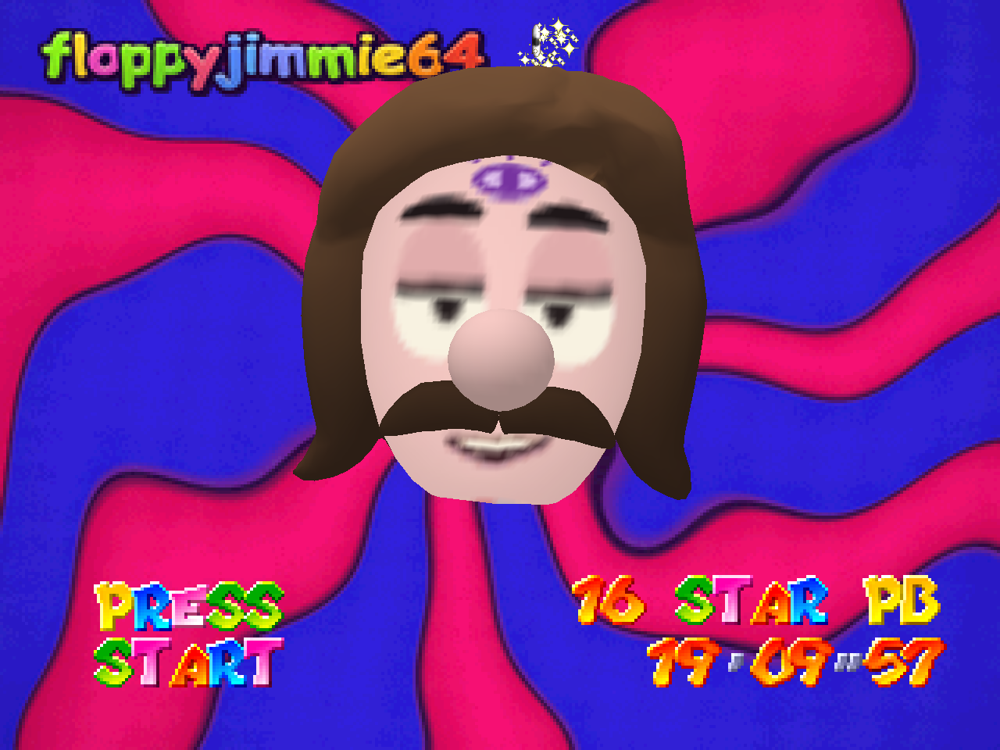
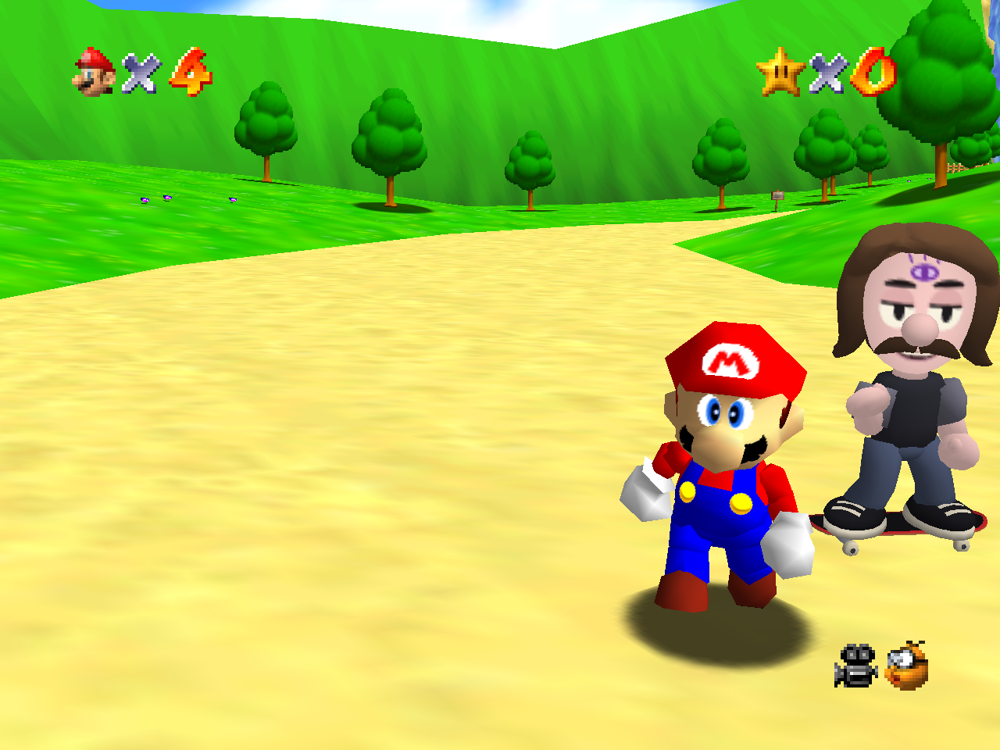

# Jimmie 64

Super Mario 64 with a skateboarding companion who talks like a real person.

You play Mario, exactly as you always have. Jimmie skates along beside you: he does tricks, grinds
rails, bails, and has something to say about what is going on. He is company, not a second player.
He never touches Mario, never helps and never gets in the way.

> **Read first:** [JIMMIE_NOTICE.md](JIMMIE_NOTICE.md). This is an unofficial fan project, not
> affiliated with Nintendo. Jimmie is the streamer floppyjimmie, used with his permission, and his
> voice in the game is an AI clone.
>
> **For adults only (18+).** Strong language and sexual humour throughout. Not for children.

## Play it

You need your own **Super Mario 64 (US) ROM** (a `.z64` file). None is included and none will be.

1. Download `Jimmie-64-windows.zip` from [Releases](https://github.com/Papa-Oso/jimmie-64/releases/latest) and unzip it anywhere.
2. Open the `Jimmie 64` folder and double-click **Play Jimmie 64**.
3. The first time, the game asks for your ROM. Drag your `.z64` file onto the game window. You only do this once.

Windows 10 or 11, 64-bit. Nothing else needs installing.

Also in the folder:

- **Play Jimmie 64 Speedrun** starts a 16-star attempt on a fresh, empty save every time. Your
  normal save is never touched.
- **Add desktop shortcut** puts an icon for each on your desktop.
- **Update Jimmie 64** opens the download page. The start screen says UPDATE READY when a newer
  version is out. Nothing installs by itself; the check reads one small public file from this
  repository and sends nothing about you.

## What is different from Mario 64

- **Jimmie is there.** You meet him on the castle bridge, where Lakitu used to introduce himself,
  and he stays with you from then on. He is also the one holding the camera.
- **He skates.** 50 named tricks (flips, shuvits, grabs, spins, grinds and slides, manuals, nollie
  and fakie versions, a few old-school ones), linked into combos, with falls that have a cause. He
  hops onto rails on every map and rides ledges around the castle.
- **He keeps up.** He swims when Mario swims and takes to the air when Mario flies.
- **He talks.** Several hundred things he really said on stream, picked for the moments they fit,
  plus lines written in his style. He stays on a subject for a while instead of jumping around.
- **Every sign and text box is in his words.**
- **You can talk back.** Type in the game's chat and he answers out loud.

Mario, the levels, the enemies and the stars are untouched.

## Speedrunning

On a new, empty file a clock runs from the moment you pick it. There is nothing to switch on.

- Head straight into the castle and it is a run. At each star the clock shows how far ahead or
  behind your best you are, and Jimmie follows the 16-star route with you.
- Take your time and the clock goes away by itself: Jimmie settles into exploring with you. The
  game decides during your first minute of control, then sticks with its answer.
- A file that already has progress is never timed. To start over, use **ERASE** on the file screen,
  pick an empty file, or use **Play Jimmie 64 Speedrun**.

**Fairness.** The rule this project is built on is that nothing may change how long a run takes.

- Jimmie cannot push, block, carry, heal, hurt or warp Mario, or collect anything.
- Text takes the same number of boxes as the Japanese release that runners play.
- We replay the same button presses on the unmodified game and on Jimmie 64 and compare Mario
  frame by frame. So far that covers the start of a run through the castle, not a whole run.
- This is the US game on a PC, with no console slowdown. Times belong on a Jimmie 64 board and are
  not comparable with console records.

## Controls

- **Z** is the left trigger (ZL / LT). **R** is the right bumper or right trigger. **L** is the left bumper.
- The **right stick** is the four C buttons. To change one, open **Options → Controls → N64 Binds**,
  select its slot, then tilt the stick or press the button you want.
- On a Nintendo controller, A and B sit in swapped positions compared with an Xbox pad. Rebind them
  in the same menu if jump feels like it is on the wrong button.
- With several controllers connected, pick yours under **Options → Controls → Gamepad**.
- To reset every control, close the game and delete `brain\profile\save\sm64config.txt`.

## Build it yourself

This repository is a fork of [sm64coopdx](https://github.com/coop-deluxe/sm64coopdx) and builds the
same way (MSYS2 MinGW64 on Windows), with Jimmie's parts switched on:

    make -j JIMMIE_NATIVE_HEAD=1 DISCORD_SDK=0 COOPNET=0 UPDATER=0
    python jimmie/setup_jimmie.py
    python jimmie/brain/play.py

More in [JIMMIE.md](JIMMIE.md). How his speech works is in [jimmie/brain/README.md](jimmie/brain/README.md).

| Folder | What it is |
|---|---|
| `mods/jimmie/` | the Jimmie mod: following, skating, tricks, rails, crashes, his recorded clips |
| `jimmie/brain/` | what decides when he speaks and what he says, with his lines and voiced line pool |
| `jimmie/movement/` | the code that generates his tricks and motion |
| `src/` | sm64coopdx, with Jimmie's changes to the game program in files named `jimmie_*` |

## What is not here

- A ROM, or anything taken from one.
- The recording used to clone his voice, and the transcripts of his streams.

## Credits

Built on [sm64coopdx](https://github.com/coop-deluxe/sm64coopdx) by the Coop Deluxe team, which
continues sm64ex-coop and rests on the Super Mario 64 decompilation. Everything that makes the port
work is theirs; see their repository for its own documentation and contributors.

Jimmie is floppyjimmie. Go watch him: <https://www.twitch.tv/floppyjimmie>
